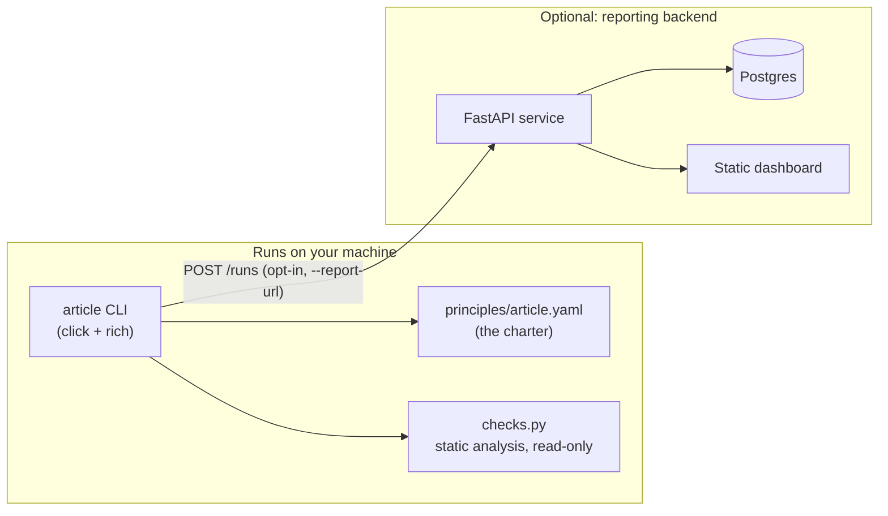

# Architecture

Article has three layers, deliberately kept separate so any one of them can
be used without the others.

## Why a YAML charter instead of hardcoded rules

`principles/article.yaml` is the single source of truth for *what* Article
checks. `src/article/checks.py` is the *how*. Splitting them means:

- the charter can be read and reasoned about by a non-programmer,
- a fork can swap in its own charter without touching the engine
  (`article check --charter my-charter.yaml`),
- adding a principle is a two-step, reviewable change: describe it in YAML,
  implement one function in `checks.py`.

## Why the CLI never executes target-project code

`checks.py` only ever calls `Path.read_text()` on files under the target
directory. It never imports, `eval`s, or shells out to anything belonging to
the project being checked. That's what makes `article check <path>` safe to
run against a repository you don't fully trust yet.

## Why the backend is optional

The CLI is fully useful with zero network access — `article check .`
requires nothing but a local Python install. The backend
(`src/article/api/`) exists only to answer one extra question teams often
want: "is our score trending up or down over time?" It is a thin FastAPI +
SQLAlchemy service; see [`render.yaml`](../render.yaml) for the deployment
blueprint and [`PRIVACY.md`](../PRIVACY.md) for exactly what it stores.
